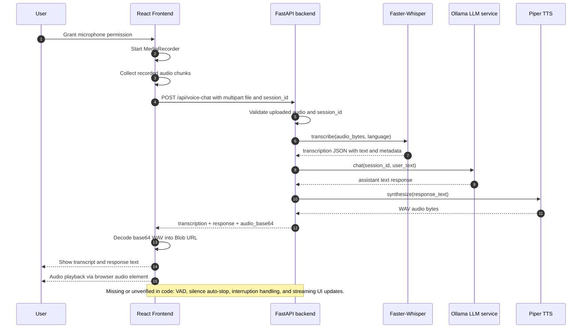
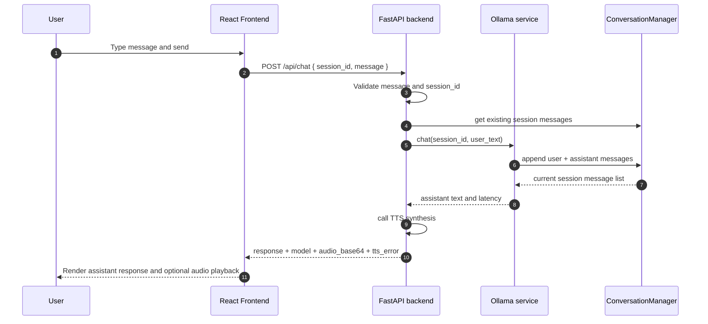
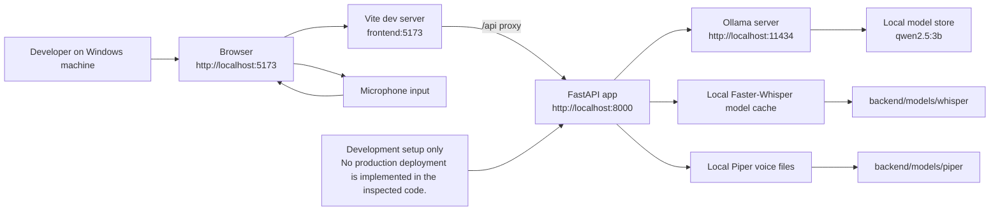

# Voice AI Assistant Architecture

This document describes the current implementation of the project in `C:\Users\hp\voice assistant`. It is intended to reflect the code that is present in the workspace as inspected, without assuming features that were not implemented or verified.

## 1. System overview

The project is a local voice assistant prototype with a browser-based frontend and a Python FastAPI backend. The application is designed around a simple local AI pipeline:

- Browser microphone input is captured with `MediaRecorder`
- Uploaded audio is sent to `/api/voice-chat` or `/api/transcribe`
- Faster-Whisper converts audio into text
- Ollama responds using the configured local model
- Piper generates a WAV audio response from the LLM text
- The frontend decodes the returned base64 WAV audio and plays it in the browser

This architecture is intentionally local-first. The code currently relies on local services and files rather than hosted inference APIs for the core STT, LLM, and TTS pipeline.

## 2. Technology stack

### Frontend
- React 18 (`frontend/package.json`)
- Vite 5 (`frontend/package.json`)
- JavaScript/JSX UI code in `frontend/src/`
- Browser `MediaRecorder` for recording audio
- Browser audio element for playback

### Backend
- Python
- FastAPI (`backend/main.py`)
- Python multipart uploads (`python-multipart` in `backend/requirements.txt`)
- HTTP client calls to local services (`httpx` in `backend/requirements.txt`)
- Configuration via `backend/config.py`

### Local AI services
- Speech-to-text: Faster-Whisper (`faster-whisper==1.1.0`)
- LLM: Ollama HTTP API at `http://localhost:11434`
- Configured model: `qwen2.5:3b` from `backend/config.py`
- TTS: Piper (`piper-tts==1.8.0`)

### Important dependency definitions
From `backend/requirements.txt`:

```text
fastapi==0.115.6
uvicorn[standard]==0.34.0
python-multipart==0.0.20
faster-whisper==1.1.0
httpx==0.28.1
piper-tts==1.8.0
websockets==14.1
numpy==1.26.4
```

## 3. Project structure

```text
C:\Users\hp\voice assistant
├── .gitignore
├── .venv/
├── ARCHITECTURE.md
├── README.md
├── backend/
│   ├── config.py
│   ├── llm_service.py
│   ├── main.py
│   ├── models/
│   │   ├── piper/
│   │   │   ├── en_US-lessac-medium.onnx
│   │   │   └── en_US-lessac-medium.onnx.json
│   │   └── whisper/
│   │       └── models--Systran--faster-whisper-base/
│   ├── requirements.txt
│   ├── stt_service.py
│   ├── tmp/
│   └── tts_service.py
├── frontend/
│   ├── package.json
│   ├── package-lock.json
│   ├── src/
│   │   ├── App.jsx
│   │   ├── App.module.css
│   │   ├── components/
│   │   ├── index.css
│   │   └── main.jsx
│   └── vite.config.js
└── .gitignore
```

### Key responsibilities by file

- `backend/config.py`: centralized configuration for Whisper, Ollama, Piper, CORS, conversation limits, and audio size
- `backend/main.py`: FastAPI application, CORS, route definitions, validation, and response assembly
- `backend/stt_service.py`: calls Faster-Whisper to transcribe uploaded audio
- `backend/llm_service.py`: sends requests to Ollama and stores per-session message history
- `backend/tts_service.py`: loads Piper voice models, synthesizes WAV output, and returns base64 audio payloads
- `frontend/src/App.jsx`: browser UI for recording, text chat, session state, and audio playback
- `frontend/vite.config.js`: Vite server configuration and `/api` proxy to `http://localhost:8000`
- `backend/models/`: local cached Whisper and Piper model files

## 4. High-level system architecture

```mermaid
flowchart LR
    subgraph Frontend[Frontend: React + Vite]
        UI[Browser UI\nApp.jsx]
        Mic[Microphone\nMediaRecorder]
        Proxy[Vite dev server\n/api proxy]
    end

    subgraph Backend[Backend: FastAPI]
        APIRoutes[FastAPI routes\n/api/health\n/api/transcribe\n/api/chat\n/api/voice-chat]
        Config[backend/config.py]
        STT[STT service\ntranscribe()]
        LLM[LLM service\nchat()]
        TTS[TTS service\nsynthesize()]
    end

    subgraph LocalAI[Local AI Services]
        Ollama[Ollama server\nhttp://localhost:11434]
        Model[Configured model\nqwen2.5:3b]
        PiperModel[Piper voice files\nen_US-lessac-medium.onnx]
        WhisperModel[Faster-Whisper cache\nbase model]
    end

    User[User] --> UI
    Mic --> UI
    UI -->|HTTP /api/chat| Proxy
    UI -->|Multipart /api/voice-chat| Proxy
    UI -->|HTTP /api/transcribe| Proxy
    Proxy -->|http://localhost:8000| APIRoutes

    APIRoutes --> STT
    APIRoutes --> LLM
    APIRoutes --> TTS

    STT --> WhisperModel
    LLM --> Ollama
    Ollama --> Model
    TTS --> PiperModel

    STT -->|Transcript JSON| APIRoutes
    LLM -->|Text response| APIRoutes
    TTS -->|WAV audio bytes| APIRoutes
    APIRoutes -->|JSON / audio payload| UI
    UI -->|audio playback| User

    Config --> STT
    Config --> LLM
    Config --> TTS
```

This diagram reflects the actual implementation structure observed in `frontend/vite.config.js`, `backend/main.py`, `backend/config.py`, and the service modules.

## 5. Voice conversation sequence diagram



The sequence reflects the present code paths in `frontend/src/App.jsx` and `backend/main.py`. It does not claim that every browser or OS-specific recording behavior has been runtime-verified.

## 6. Text-chat sequence diagram



This sequence is supported by the actual route handler and `ConversationManager` implementation in `backend/llm_service.py`.

## 7. Audio data-flow diagram

```mermaid
flowchart TD
    Mic[Microphone input] --> Recorder[MediaRecorder
records Blob chunks]
    Recorder --> AudioBlob[Recorded Blob]
    AudioBlob --> FormData[FormData upload\nfile + session_id + language]
    FormData --> Upload[HTTP POST /api/voice-chat]
    Upload --> Backend[FastAPI backend\nmain.py]
    Backend --> Read[Read uploaded bytes\n_read_audio()]
    Read --> Validate{Valid / non-empty / <= MAX_AUDIO_SIZE?}
    Validate -->|Yes| STT[Faster-Whisper\ntranscribe()]
    Validate -->|No| Error[400 / 413 / 422 error]
    STT --> Transcript[Transcript JSON\ntext, language, duration, segments]
    Transcript --> LLM[Ollama LLM chat()]
    LLM --> Response[Assistant response text]
    Response --> TTS[Piper synthesize()\nWAV output]
    TTS --> WAV[WAV bytes]
    WAV --> HTTPResp[HTTP response body\naudio_base64 + response]
    HTTPResp --> Decode[Frontend decodeAudio()\nwindow.atob()]
    Decode --> BlobURL[Blob URL\naudio/wav]
    BlobURL --> Player[HTML audio element\nplay()]
    Player --> Speaker[Speaker output]

    Note1[Note: MediaRecorder output format depends on browser/OS.\nThe code treats it as a generic Blob and the backend reads raw bytes.] --> Recorder
```

This flow reflects the actual frontend behavior in `frontend/src/App.jsx` and the backend route logic in `backend/main.py`.

## 8. Backend component diagram

```mermaid
flowchart TD
    Request[HTTP request] --> Routes[FastAPI app in backend/main.py]
    Routes --> Health[GET /api/health]
    Routes --> Transcribe[POST /api/transcribe]
    Routes --> Chat[POST /api/chat]
    Routes --> VoiceChat[POST /api/voice-chat]

    Health --> CheckHealth[llm_service.check_health()]
    CheckHealth --> Ollama[Ollama /api/tags]
    Ollama --> HealthResp[status + online + model availability]

    Transcribe --> STTFunction[stt_service.transcribe(audio_bytes, language)]
    STTFunction --> WhisperModel[Faster-Whisper model]
    WhisperModel --> TranscribeResp[JSON: text, language, duration, segments]

    Chat --> LLMChat[llm_service.chat(session_id, user_text)]
    LLMChat --> History[ConversationManager session history]
    LLMChat --> OllamaLLM[Ollama /api/chat]
    OllamaLLM --> ChatResp[response + latency + model]

    VoiceChat --> CombinedFlow[validate file + transcribe + chat + TTS]
    CombinedFlow --> STTFunction
    CombinedFlow --> LLMChat
    CombinedFlow --> TTSFunction[tts_service.synthesize(text)]
    TTSFunction --> PiperVoice[Piper voice model]
    PiperVoice --> AudioResp[WAV audio bytes]

    Config[backend/config.py] --> Routes
    Config --> STTFunction
    Config --> LLMChat
    Config --> TTSFunction
```

This diagram maps each route to the actual service functions and configuration values used in the code.

## 9. Deployment diagram



This describes the current local development topology. The project code does not currently define a production deployment pipeline or a containerized deployment environment.

## 10. API contracts

The following route details are based directly on the route handlers in `backend/main.py` and the frontend request calls in `frontend/src/App.jsx`.

### 10.1 GET /api/health

- Method: `GET`
- Path: `/api/health`
- Content type: `application/json`
- Service call: `check_health()` from `backend/llm_service.py`
- Response fields:
  - `status` (`"ok"` or `"degraded"`)
  - `ollama.online`
  - `ollama.model`
  - `ollama.model_available`
  - `ollama.available_models`
- Error handling: checks connection errors and model availability; returns degraded status rather than throwing an exception
- Verification status: inspected statically; runtime status was not part of this documentation pass

Example response:

```json
{
  "status": "ok",
  "ollama": {
    "online": true,
    "model": "qwen2.5:3b",
    "model_available": true,
    "available_models": ["qwen2.5:3b"]
  }
}
```

### 10.2 POST /api/transcribe

- Method: `POST`
- Path: `/api/transcribe`
- Content type: `multipart/form-data`
- Required form field: `file`
- Optional form field: `language`
- Service call: `transcribe(audio_bytes, language)` in `backend/stt_service.py`
- Response fields:
  - `text`
  - `language`
  - `language_probability`
  - `duration`
  - `latency`
  - `segments`
- Error handling:
  - empty upload -> `400`
  - excessive file size -> `413`
  - transcription failure -> `503`
- Verification status: static inspection only; no runtime transcript result was asserted here

Example response:

```json
{
  "text": "hello there",
  "language": "en",
  "language_probability": 0.99,
  "duration": 2.4,
  "latency": 0.81,
  "segments": [{"start": 0.0, "end": 2.4, "text": "hello there"}]
}
```

### 10.3 POST /api/chat

- Method: `POST`
- Path: `/api/chat`
- Content type: `application/json`
- Request body:

```json
{
  "session_id": "abc123",
  "message": "Hello there"
}
```

- Service call: `chat(session_id, user_text)` in `backend/llm_service.py`
- Response fields:
  - `response`
  - `model`
  - `latency`
  - `audio_base64`
  - `audio_format`
  - `tts_error`
- Error handling:
  - blank message -> `422`
  - connection failure -> `503`
  - timeout -> `504`
  - runtime LLM error -> `502`
- Verification status: statically implemented and consistent with frontend request payload; end-to-end runtime not proven by this documentation pass

### 10.4 POST /api/voice-chat

- Method: `POST`
- Path: `/api/voice-chat`
- Content type: `multipart/form-data`
- Required form fields: `file`, `session_id`
- Optional form field: `language`
- Service calls:
  1. `transcribe(audio_bytes, language)`
  2. `chat(session_id, user_text)`
  3. `synthesize(response_text)`
- Response fields:
  - `transcription` object
  - `response`
  - `model`
  - `latency`
  - `audio_base64`
  - `audio_format`
  - `tts_error`
- Error handling:
  - empty audio -> `400`
  - oversized upload -> `413`
  - no recognized speech -> `422`
  - STT failure -> `503`
  - chat failures -> `503`, `504`, or `502`
- Verification status: code defines the flow and payload, but final runtime validation is still separate from static inspection

## 11. State and conversation management

The message history logic is implemented in `backend/llm_service.py` via `ConversationManager`.

Current behavior confirmed by code:

- conversation histories are tracked per `session_id`
- user and assistant messages are appended to a per-session list
- history is trimmed when it exceeds `MAX_CONVERSATION_TURNS * 2`
- a system prompt is included in every Ollama request
- the frontend persists `session_id` in browser local storage

This means conversation continuity is maintained in memory on the backend and in browser local storage for the frontend session key. It does not appear to be persisted to a database or file store in the inspected implementation.

## 12. Error handling and observability

The current implementation includes several explicit checks and exceptions.

### Existing validation
- blank text message is rejected in `backend/main.py`
- uploaded audio must not be empty
- uploaded audio must stay under `MAX_AUDIO_SIZE_MB`
- `session_id` is required for chat requests and has length constraints

### Exception handling
- `FastAPI` route handlers catch connection, timeout, and runtime errors from downstream services
- HTTP response codes are returned: `400`, `413`, `422`, `503`, `504`, and `502`
- TTS errors are not fatal to the text response; the code returns `tts_error` alongside the response text

### Logging
- backend modules use `logging.getLogger(__name__)`
- startup logging is configured in the FastAPI lifespan handler
- info logs are produced for Whisper loading, LLM latency, and TTS completion

### Observability gaps
- no dedicated metrics endpoint or latency aggregation was found
- no automated test suite was found in the repository during static inspection
- no explicit tracing instrumentation or structured JSON logging configuration was found

## 13. Security and privacy

The code shows several important local-processing characteristics:

- the core AI stack runs locally: Whisper, Ollama, and Piper are not configured as hosted paid services
- audio is uploaded to the local backend and processed locally
- CORS is enabled from configured origins in `backend/config.py`
- request/response payloads are not hidden behind authentication or authorization in the code inspected
- uploaded audio and text messages are kept in memory for session-based conversation handling

The implementation is local-first, but the code does not provide evidence of a hardened production security model. In particular:

- no auth layer was found
- no persistence or encryption layer was found
- microphone access requires browser permissions from the user
- ports 5173 (frontend) and 8000 (backend) are development endpoints, not production endpoints

## 14. Current limitations and future architecture

### Implemented
- React + Vite frontend for chat and mic capture
- FastAPI backend with health, text, and voice routes
- Faster-Whisper transcription
- Ollama-based local LLM chat with session memory
- Piper TTS generation to WAV
- Browser playback of generated speech

### Missing or unverified
- VAD or silence-based automatic recording stop
- interruption handling while speech is playing
- streaming LLM responses
- multilingual voice selection beyond passing `language` to transcription
- automated backend and frontend test suite
- persistent database storage for conversation history
- production deployment packaging
- latency benchmarking and monitoring

### Recommended future architecture improvements
1. Add VAD and configurable silence threshold handling before the backend request is sent
2. Add explicit UI states for listening, thinking, speaking, and error
3. Add structured logging and latency metrics per stage
4. Add persistence for sessions and conversations if the app is to continue beyond the prototype
5. Add automated tests that mock the local AI services instead of requiring live downloads or local inference in CI
6. Separate development configuration from production deployment configuration

## 15. Files inspected

The following files were inspected while preparing this architecture document:

- `C:\Users\hp\voice assistant\.gitignore`
- `C:\Users\hp\voice assistant\backend\config.py`
- `C:\Users\hp\voice assistant\backend\llm_service.py`
- `C:\Users\hp\voice assistant\backend\main.py`
- `C:\Users\hp\voice assistant\backend\requirements.txt`
- `C:\Users\hp\voice assistant\backend\stt_service.py`
- `C:\Users\hp\voice assistant\backend\tts_service.py`
- `C:\Users\hp\voice assistant\frontend\package.json`
- `C:\Users\hp\voice assistant\frontend\vite.config.js`
- `C:\Users\hp\voice assistant\frontend\src\App.jsx`
- `C:\Users\hp\voice assistant\frontend\src\components\AudioPlayer.jsx`
- `C:\Users\hp\voice assistant\frontend\src\components\TextInput.jsx`

## 16. Verification summary

This document intentionally distinguishes between:

- code-defined behavior: supported directly by the source files
- runtime-verified behavior: not asserted here because no live execution or browser validation was performed in this documentation-only task

The diagrams and route details in this file are designed to match the implementation as it exists in the inspected codebase. They are GitHub-compatible Mermaid diagrams intended to render correctly in Markdown viewers that support Mermaid.
 without eliminating the assistant text response

The backend also includes a basic health check that verifies whether Ollama is reachable and whether the configured model is available.

Important dependencies:

- FastAPI must be running on port 8000
- Vite dev server must run on port 5173
- Ollama must be running locally on 11434
- Audio files must be valid and under the configured size limit
- Browser microphone permission must be granted
- Local model files must be present before inference starts

## Security and privacy considerations

- The design is local-first; the project does not rely on paid hosted AI inference APIs for the core STT, LLM, or TTS steps.
- Audio and conversation text are processed locally on the same machine where the backend and Ollama service are running.
- The backend adds CORS support using configured origins from `backend/config.py`.
- The code does not appear to persist chat history to a database in the inspected implementation.
- The backend stores session history in memory only, so it is reset when the server restarts.

This design keeps data local but is not intended as a full production privacy or retention system.

## Current limitations and proposed improvements

The current implementation is a useful local prototype, but several limitations remain in the code as inspected:

- No explicit VAD or automatic silence-based stop detection
- No interruption handling for a speaking assistant response
- No persistent database-backed conversation history
- No structured latency instrumentation or benchmarking workflow
- No frontend test suite or backend unit test suite found in the repository
- No multi-language voice selection logic beyond a `language` form field passed into transcription
- Browser audio behavior can vary by browser and OS, especially when handling media formats like WebM or OGG

Recommended next improvements:

1. Add robust VAD and silence-based stopping
2. Add explicit listening, thinking, and speaking UI states
3. Add model health checks, timeouts, and improved logging
4. Add automated tests for backend and frontend behavior
5. Document measured latency and actual hardware used for benchmarking

## Summary

The project architecture is intentionally simple: browser capture → FastAPI → local Whisper/Ollama/Piper → browser playback. It is a good local rapid prototype, and it is already structured around the essential local AI pipeline. The remaining work is primarily runtime verification, error handling, UX polishing, and the addition of production-quality documentation and validation.
