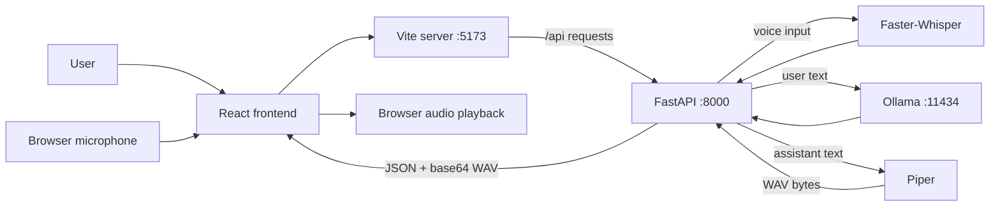

# Voice AI Assistant Architecture

## Overview

Voice AI Assistant is a local development application. A React and Vite frontend communicates with a FastAPI backend, which coordinates Faster-Whisper transcription, Ollama chat, and Piper speech synthesis.

The supported conversation languages are English (`en`) and Hindi (`hi`). English is the default. Hindi responses are checked for Devanagari script; invalid-script responses are retried once and then replaced with a Hindi fallback if validation still fails.

## Components

| Component | Responsibility |
| --- | --- |
| React frontend | Text input, microphone recording, language selection, conversation display, and audio playback |
| Vite development server | Serves the frontend on port `5173` and proxies `/api` requests to FastAPI on port `8000` |
| FastAPI backend | Validates requests and coordinates transcription, chat, and speech synthesis |
| Faster-Whisper | Transcribes uploaded audio using the selected language |
| Ollama | Generates assistant responses using the configured local model, `qwen2.5:3b` by default |
| Piper | Synthesizes WAV audio using the English or Hindi voice |

The English Piper voice defaults to `en_US-lessac-medium`. The Hindi voice defaults to `hi_IN-rohan-medium` and is downloaded on first use if it is not already present.

## System Flow

## Request Flows

### Text chat

1. The frontend sends `session_id`, `message`, and `language` to `POST /api/chat`.
2. FastAPI validates the request and calls the Ollama chat service.
3. The chat service adds the selected-language instruction and the session's in-memory history to the model request.
4. Hindi output is checked for Devanagari script. A response that fails the check is retried once; a Hindi fallback is used if the retry also fails.
5. FastAPI synthesizes speech with the matching Piper voice and returns the response text and audio payload. If TTS fails, the text is still returned with `tts_error` populated.
6. The frontend displays the reply and attempts playback. A manual Play control is available if browser autoplay is blocked.

### Voice chat

1. The browser records microphone input with `MediaRecorder` and packages the recording as a multipart upload.
2. The frontend sends `file`, `session_id`, and `language` to `POST /api/voice-chat`.
3. FastAPI validates the upload and sends the audio bytes to Faster-Whisper with the selected language.
4. The transcript is sent to Ollama with the selected response language and session history.
5. The assistant response is synthesized with the corresponding Piper voice.
6. FastAPI returns the transcript, response text, and base64-encoded WAV audio. The frontend displays the text and provides audio playback.

The separate `POST /api/transcribe` endpoint performs only the transcription step.

## API Contracts

| Method and route | Input | Behavior |
| --- | --- | --- |
| `GET /api/health` | None | Reports Ollama reachability and configured-model availability |
| `POST /api/transcribe` | Multipart: `file`, optional `language` | Returns transcript and transcription metadata |
| `POST /api/chat` | JSON: `session_id`, `message`, optional `language` | Returns assistant text and synthesized audio when available |
| `POST /api/voice-chat` | Multipart: `file`, `session_id`, optional `language` | Transcribes audio, generates a response, and synthesizes speech |

The `language` value is restricted to `en` or `hi` and defaults to `en`. Unsupported values are rejected during request validation. Audio uploads are limited by `MAX_AUDIO_MB` (25 MB by default).

Common error responses include `400` for empty audio, `413` for oversized uploads, `422` for invalid requests or unrecognized speech, and `503` when transcription or Ollama connectivity fails. Ollama timeouts return `504`; other Ollama errors return `502`.

## State and Configuration

- The frontend creates a session ID in React state when the page loads. **Clear conversation** creates a new session ID; session IDs are not persisted in localStorage.
- The backend stores conversation history in process memory, limited by `MAX_TURNS` (20 by default). History is lost when the backend restarts.
- Language selection is held in frontend state and sent with each chat or voice request.
- Backend settings are defined in `backend/config.py` and can be overridden with environment variables. See [README.md](README.md#configuration) for the configuration reference.

## Source Layout

| Path | Responsibility |
| --- | --- |
| `frontend/src/App.jsx` | Application state, API calls, microphone recording, and language selection |
| `frontend/src/components/ConversationArea.jsx` | Renders conversation messages |
| `frontend/src/components/MessageBubble.jsx` | Renders individual messages and assistant audio controls |
| `frontend/src/components/AudioPlayer.jsx` | Plays returned audio and handles browser playback failures |
| `frontend/vite.config.js` | Vite configuration and backend API proxy |
| `backend/main.py` | FastAPI routes, request validation, and response assembly |
| `backend/stt_service.py` | Faster-Whisper model loading and transcription |
| `backend/llm_service.py` | Ollama requests, language checks, and in-memory conversation history |
| `backend/tts_service.py` | Language-specific Piper voice loading and WAV synthesis |
| `backend/config.py` | Model, server, upload, and conversation configuration |

## Development Topology and Constraints

The development services use these default endpoints:

- Frontend: `http://localhost:5173`
- FastAPI backend: `http://localhost:8000`
- Ollama: `http://localhost:11434`

The Vite development server proxies API requests to FastAPI. The project does not define a production deployment, authentication layer, or persistent database. Microphone recording requires browser permission and works on `localhost` or another secure origin.

The repository does not currently include an automated test suite. Voice activity detection, silence-based recording termination, playback interruption, streaming responses, and production latency metrics are not implemented.