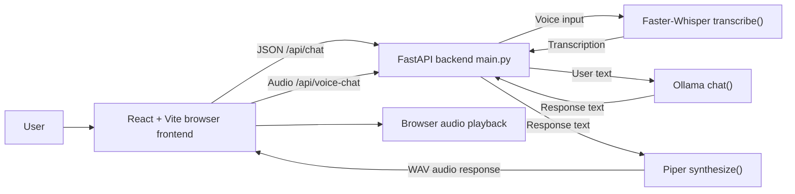

# Voice AI Assistant

## Overview

This project is a local voice assistant prototype built with a React + Vite frontend and a Python + FastAPI backend. The backend integrates:

- Faster-Whisper for speech-to-text
- Ollama for local LLM chat with per-session memory
- Piper for local text-to-speech

The current implementation is designed to run locally on the same machine without paying for hosted inference services. The frontend can record audio in the browser, send it to the backend, display transcription and assistant responses, and play returned WAV audio.

## Implemented features

The following behaviors are present in the codebase inspected in this project:

- React frontend served with Vite on `http://localhost:5173`
- FastAPI backend with `/api/health`, `/api/transcribe`, `/api/chat`, and `/api/voice-chat` routes
- Browser microphone recording via `MediaRecorder`
- Audio file upload to the backend
- Faster-Whisper transcription of uploaded audio
- Local Ollama chat using a configured model and per-session message history
- Piper-based speech synthesis to WAV audio
- Frontend display of user transcription and assistant text
- Frontend audio playback for TTS output
- Basic error handling for empty audio, failed requests, and TTS failures

## Planned or not yet verified features

The following are either not implemented in the current code or were not verified during this review:

- Voice Activity Detection (VAD) / silence-based auto-stop
- Interruptions while the assistant is speaking
- Automatic language detection for Hindi/English beyond the explicit `language` form field in the API
- Production-grade latency metrics and benchmarking
- Automated backend/frontend tests
- Full browser end-to-end validation of microphone → transcription → LLM → TTS → playback
- A polished production README and architecture documentation

## Technology stack

### Frontend
- React 18
- Vite 5
- JavaScript (JSX)

### Backend
- Python 3.11-compatible environment
- FastAPI
- Python multipart uploads
- Faster-Whisper
- httpx
- Ollama HTTP API
- Piper TTS

### Local AI dependencies
- STT: Faster-Whisper using the `base` model in backend config
- LLM: Ollama model configured as `qwen2.5:3b`
- TTS: Piper voice configured as `en_US-lessac-medium`

## Actual project directory structure

```text
C:\Users\hp\voice assistant
├── .gitignore
├── .venv/
├── backend/
│   ├── config.py
│   ├── llm_service.py
│   ├── main.py
│   ├── models/
│   │   ├── piper/
│   │   │   ├── en_US-lessac-medium.onnx
│   │   │   └── en_US-lessac-medium.onnx.json
│   │   └── whisper/
│   │       └── models--Systran--faster-whisper-base/
│   ├── requirements.txt
│   ├── stt_service.py
│   ├── tmp/
│   └── tts_service.py
├── frontend/
│   ├── node_modules/
│   ├── package.json
│   ├── package-lock.json
│   ├── src/
│   │   ├── App.jsx
│   │   ├── App.module.css
│   │   ├── components/
│   │   ├── index.css
│   │   └── main.jsx
│   └── vite.config.js
└── README.md
```

Notes:
- A project-level `README.md` and `ARCHITECTURE.md` are intentionally being added as documentation only.
- The root `.gitignore` includes common Python and frontend generated files.
- The backend `models` directory currently contains a cached Faster-Whisper model and a Piper voice model file.

## Architecture overview



## Prerequisites

The project expects a local Windows development setup with:

- Python 3.11-compatible virtual environment in `.venv`
- Node.js and npm for the frontend
- Ollama installed locally and running on `http://localhost:11434`
- Access to microphone permissions in the browser
- Local model files already available or downloadable by the respective libraries

## Installation and setup

### 1) Activate the virtual environment

In Windows PowerShell:

```powershell
cd "C:\Users\hp\voice assistant"
.\.venv\Scripts\Activate.ps1
```

### 2) Install backend dependencies

```powershell
cd "C:\Users\hp\voice assistant\backend"
python -m pip install -r requirements.txt
```

### 3) Start the FastAPI backend

```powershell
cd "C:\Users\hp\voice assistant\backend"
python -m uvicorn main:app --host 0.0.0.0 --port 8000 --reload
```

### 4) Install frontend dependencies

```powershell
cd "C:\Users\hp\voice assistant\frontend"
npm install
```

### 5) Start the Vite frontend

```powershell
cd "C:\Users\hp\voice assistant\frontend"
npm run dev
```

Then open:

```text
http://localhost:5173/
```

## Ollama setup and configured model

The backend configuration file is `backend/config.py` and contains the following actual defaults:

```python
OLLAMA_BASE_URL = os.getenv("OLLAMA_URL", "http://localhost:11434")
OLLAMA_MODEL = os.getenv("OLLAMA_MODEL", "qwen2.5:3b")
OLLAMA_TIMEOUT = int(os.getenv("OLLAMA_TIMEOUT", "120"))
```

This means the project currently expects Ollama to be running locally and the model `qwen2.5:3b` to be available. The health endpoint checks for Ollama and confirms the configured model is available.

Typical local Ollama setup on Windows:

```powershell
ollama serve
ollama pull qwen2.5:3b
```

The project does not currently document any alternative model override beyond the environment variable `OLLAMA_MODEL`.

## Environment variables and configuration

The current backend configuration is defined in `backend/config.py`.

### Actual environment variables used

- `WHISPER_MODEL` — defaults to `base`
- `WHISPER_DEVICE` — defaults to `cpu`
- `WHISPER_COMPUTE` — defaults to `int8`
- `WHISPER_LANG` — defaults to `None`
- `OLLAMA_URL` — defaults to `http://localhost:11434`
- `OLLAMA_MODEL` — defaults to `qwen2.5:3b`
- `OLLAMA_TIMEOUT` — defaults to `120`
- `PIPER_VOICE` — defaults to `en_US-lessac-medium`
- `PIPER_SPEAKER` — defaults to `0`
- `PIPER_SPEED` — defaults to `1.0`
- `MAX_AUDIO_MB` — defaults to `25`
- `CORS_ORIGINS` — defaults to `http://localhost:5173,http://localhost:3000`
- `MAX_TURNS` — defaults to `20`

### Example environment values

```text
OLLAMA_URL=http://localhost:11434
OLLAMA_MODEL=qwen2.5:3b
WHISPER_MODEL=base
WHISPER_DEVICE=cpu
PIPER_VOICE=en_US-lessac-medium
MAX_AUDIO_MB=25
CORS_ORIGINS=http://localhost:5173,http://localhost:3000
```

## API endpoints

All routes are defined in `backend/main.py`.

### `GET /api/health`

Returns health information for the backend and Ollama availability.

Example response:

```json
{
  "status": "ok",
  "ollama": {
    "online": true,
    "model": "qwen2.5:3b",
    "model_available": true,
    "available_models": ["qwen2.5:3b"]
  }
}
```

The response uses a degraded status when Ollama is not online or the configured model is unavailable.

### `POST /api/transcribe`

Request:
- Form field `file` required
- Optional form field `language` as a short language code (for example `en` or `hi`)

Response:

```json
{
  "text": "hello there",
  "language": "en",
  "language_probability": 0.99,
  "duration": 2.4,
  "latency": 0.81,
  "segments": [
    {"start": 0.0, "end": 2.4, "text": "hello there"}
  ]
}
```

Errors:
- Empty or oversized file returns HTTP 400/413
- Speech-to-text exceptions return HTTP 503

### `POST /api/chat`

Request body:

```json
{
  "session_id": "abc123",
  "message": "Hello there"
}
```

Response shape:

```json
{
  "response": "Hi! How can I help?",
  "model": "qwen2.5:3b",
  "latency": 1.42,
  "audio_base64": "...",
  "audio_format": "wav",
  "tts_error": null
}
```

Notes:
- The `message` field is required and trimmed before processing.
- The chat service maintains a per-session conversation list in memory.
- If TTS generation fails, the assistant text is still returned and `tts_error` is populated.

### `POST /api/voice-chat`

Request:
- Multipart form field `file` required
- Multipart form field `session_id` required
- Optional multipart form field `language`

Response includes both transcription and text response, plus audio payload if TTS succeeds:

```json
{
  "transcription": {
    "text": "hello there",
    "language": "en",
    "language_probability": 0.99,
    "duration": 2.4,
    "latency": 0.81,
    "segments": []
  },
  "response": "Hi! How can I help?",
  "model": "qwen2.5:3b",
  "latency": 1.42,
  "audio_base64": "...",
  "audio_format": "wav",
  "tts_error": null
}
```

## How to use the application

1. Start Ollama locally.
2. Start the backend with FastAPI.
3. Start the frontend with Vite.
4. Open `http://localhost:5173/` in a browser.
5. Either:
   - type a message and send it, or
   - click the microphone and record audio
6. The backend returns the transcribed text, assistant message, and audio response if TTS succeeds.
7. Browser audio playback is available through the frontend audio player component.

## Troubleshooting

### Microphone permissions

- Allow microphone access when the browser prompts.
- Use `localhost` or `127.0.0.1`; browser microphone access is often restricted on non-localhost origins.
- If unavailable, the frontend shows a browser permission error.

### Transcription issues

- Check that the uploaded audio is valid and not empty.
- Confirm the server is running and the backend route is reachable.
- Confirm the Faster-Whisper model is available in `backend/models/whisper`.
- Use a clear voice close to the microphone.

### Ollama issues

- Ensure `ollama serve` is running.
- Confirm the model exists locally:

```powershell
ollama list
```

- Confirm the configured model `qwen2.5:3b` is installed.

### TTS issues

- Ensure the Piper voice files exist under `backend/models/piper`.
- Confirm `piper-tts` was installed correctly in the backend environment.
- If TTS fails, the backend still returns the assistant text with `tts_error` set.

### Audio playback issues

- Browser autoplay may be blocked until a user interaction occurs; the frontend includes playback controls.
- Confirm the response payload contains `audio_base64` and the browser can decode WAV audio.
- If playback fails, the UI shows an error message and the text response remains available.

## Testing instructions

No automated test suite was identified in this project during inspection.

The repository currently contains:
- frontend source files and build scripts
- backend Python modules
- no discovered `pytest`/`vitest` test files
- no `.vscode` workspace config files

For a manual validation workflow, run these in order:

1. Start Ollama
2. Start backend
3. Start frontend
4. Check `GET /api/health`
5. Submit a text chat request
6. Upload a short recorded audio clip
7. Confirm transcription and assistant response appear in the app
8. Verify generated audio can play in the browser

## Limitations and future improvements

- No dedicated VAD implementation is present in the inspected code.
- No interruption or ongoing speech cancellation logic is currently implemented.
- Millisecond-level latency metrics are not instrumented at the project level.
- The project currently relies on in-memory conversation state and does not persist chats across restarts.
- The backend does not currently provide an explicit streaming chat UI path.
- Frontend audio format handling is browser-dependent because `MediaRecorder` output may vary by browser and OS.
- The current project is a working local prototype rather than a fully hardened production deployment.

## Notes

This documentation reflects the files and code that are actually present in the workspace as inspected. Features not present in code, or not validated in this review, are explicitly marked as unverified or planned.
